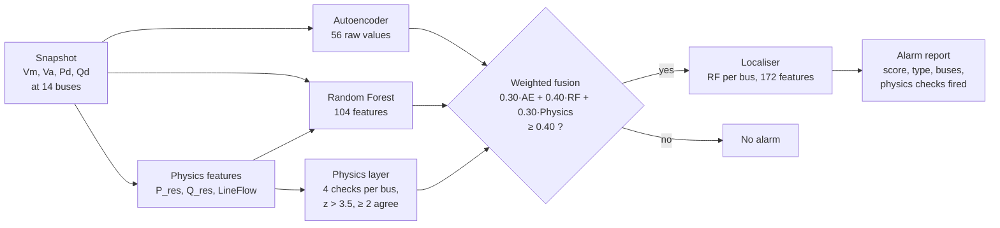

# GridDefense

**Hybrid Machine Learning and Physics-Based Detection and Localisation of False Data Injection Attacks in Smart Grids.**

GridDefense checks one measurement snapshot of the grid at a time and answers four questions:

1. **Is this snapshot attacked?** An autoencoder, a Random Forest and a physics validation layer each score the snapshot, and a weighted fusion decides.
2. **What kind of attack is it?** Additive, Scaling or Coordinated (Random Forest).
3. **Which buses were attacked?** A topology-aware Random Forest localiser, one model per bus.
4. **Why was the alarm raised?** The alarm report lists the fusion score and its three parts, and which physics checks fired at which bus.

Capstone project, College of Information Technology, Lusail University (2025/2026). All data is **simulated**; nothing was tested on a real grid or real PMU/SCADA equipment.

---

## Main results (independent test set)

11,000 snapshots (5,000 normal, 6,000 attacked) generated with a seed never used for training or tuning (`20261014`). All numbers are from `notebook/GridDefense_Final.ipynb`, Section 10.

| Detector | Detection % [95% CI] | False alarms % [95% CI] | AUC |
|---|---|---|---|
| Autoencoder alone | 99.40 [99.17–99.57] | 3.66 [3.17–4.22] | 0.9990 |
| Random Forest alone | 99.33 [99.09–99.51] | 0.42 [0.27–0.64] | 0.9997 |
| Physics layer alone | 99.10 [98.83–99.31] | 1.70 [1.38–2.10] | 0.9972 |
| 2-of-3 voting | 99.52 [99.31–99.66] | 0.36 [0.23–0.57] | — |
| **Weighted fusion (GridDefense)** | **99.32 [99.07–99.50]** | **0.30 [0.18–0.49]** (15 of 5,000) | **0.9998** |

| Task | Result |
|---|---|
| Attack type (RF, 4 classes) | 89.55 % accuracy, macro F1 0.8571 |
| Bus localisation (attacked snapshots) | 96.35 % exact set of buses, micro F1 99.12 %, 0.82 % false localisation on normal snapshots |
| Detected **and** exactly localised | 95.85 % of all attacks |

**Known limits** (all measured in the notebook):

- attacks smaller than about 1 % of the true value are mostly missed;
- attacks that keep every measurement consistent and the loads in the normal range (stealth level L4) are not detected from a single snapshot;
- angle-only attacks such as simulated GPS spoofing are caught by the physics layer and the classical bad-data test, but the fusion is weaker on them and the localiser fails;
- on the external fdia-graph benchmark (only 9 of 14 buses metered), the retrained method detects 82.12 % at 0.65 % false alarms and localises 48.31 % exactly.

---

## How it works



- **Data.** PYPOWER solves an AC power flow for each snapshot, with every bus load scaled by its own random factor (0.8–1.2). Attacks change the measured voltage at 1–3 buses by 1–3 % (Additive and Coordinated also shift the angle, by at most 0.5°). Meter noise is added after the attack (0.002 p.u. on Vm, 0.115° on Va, 1 % on powers).
- **Autoencoder** (56 → 40 → 24 → 24 → 24 → 40 → 56) is trained on **normal** training snapshots only; alarm when the reconstruction error exceeds the validation-normal mean + 2 SD.
- **Random Forest** (500 trees) learns the attack type from the 56 raw measurements plus 48 physics features.
- **Physics layer**: active- and reactive-power mismatch, and angle and voltage differences to neighbouring buses, each standardised on normal training data. A bus is flagged when at least 2 of the 4 checks exceed z = 3.5.
- **Fusion** weights and threshold, the AE threshold, the physics z and the localiser threshold are all chosen on the **validation** split only.

---

## Repository layout

```
GridDefense/
├── notebook/
│   └── GridDefense_Final.ipynb   ← the reference: every reported number comes from here (with outputs)
├── src/griddefense/              ← the main pipeline (notebook Sections 1–10) as a Python package
│   ├── config.py                 all experiment settings (seeds, sizes, noise, model settings)
│   ├── grid.py                   IEEE 14-bus network and AC power flow
│   ├── data.py                   data generator, the three attack types, 70/15/15 split
│   ├── features.py               physics features (104) and topology features (172)
│   ├── physics.py                physics validation layer
│   ├── models.py                 autoencoder, Random Forest, localiser
│   ├── fusion.py                 weighted fusion
│   ├── pipeline.py               GridDefense: fit / predict / alarm report / save / load
│   ├── bad_data.py               classical baseline: WLS state estimation + chi-square test
│   └── gps.py                    simulated GPS-spoofing (angle-only) attack
├── scripts/
│   ├── generate_data.py          builds the development and independent test datasets
│   ├── train.py                  trains GridDefense and saves the models
│   └── evaluate.py               scores the independent test set, writes a summary and alarm log
├── tests/                        checks that the package behaves like the notebook
├── data/                         the datasets (see data/README.md)
├── results/                      result tables and figures saved by the notebook, MANIFEST.json
└── models/                       how to get the trained models (see models/README.md)
```

---

## Getting started

### Option 1 — the notebook (reproduces everything)

Open `notebook/GridDefense_Final.ipynb` in Google Colab and run all cells in order. Results are written to Google Drive (`MyDrive/GridDefense/final_notebook`). A full run takes a long time on Colab's free CPU (the later experiment sections are the slowest).

### Option 2 — the Python package (main pipeline only)

```bash
python -m venv .venv && source .venv/bin/activate      # Windows: .venv\Scripts\activate
pip install -r requirements.txt
pip install -e .

pytest -q                                   # checks (about 10 seconds)
python scripts/generate_data.py             # datasets → data/
python scripts/train.py                     # models   → models/trained/
python scripts/evaluate.py                  # results  → results/package_run/
```

```python
import pandas as pd
from griddefense import GridDefense

gd = GridDefense.load("models/trained")
test = pd.read_csv("data/test_dataset_seed20261014.csv")
out = gd.predict(test)
print(gd.report(out, 0))       # readable alarm report for snapshot 0
```

**What the package does and does not cover.** The package re-implements the main pipeline (notebook Sections 1–10). The extra experiments stay in the notebook only: unseen attack type (11), attack size (12), physics ablation (13), stealthy attacks (14–15), the classical-test comparison and its combination with GridDefense (16, 16c), GPS spoofing (16b), the external benchmark (17) and the model comparison (18). The package contains the building blocks for some of them (`bad_data.py`, `gps.py`).

**Checked: the package reproduces the notebook.** Run here with the notebook's library versions (Python 3.13.16, NumPy 2.1.3, pandas 2.2.3, scikit-learn 1.6.1, TensorFlow 2.21.0) on a 2-core CPU:

- `generate_data.py` (about 3 minutes) rebuilt the development data with the same statistics the notebook prints (2.145 attacked buses per attacked snapshot; 2.00 / 1.98 / 2.46 per type; 0.9 % of attacked-bus Vm readings inside the normal range);
- `train.py` (about 5 minutes) chose the same settings: AE seed 123 (validation losses 0.008098 / 0.005820 / 0.006168 / 0.006167), AE threshold 0.009477, physics z = 3.5, localiser threshold 0.31, fusion 0.30 / 0.40 / 0.30 at 0.40 (validation F1 0.9972);
- `evaluate.py` gave the same independent-test results as the notebook's Section 10 table above, to two decimals: fusion 99.32 % / 0.30 %, RF 89.55 % (macro F1 0.8571), localisation 96.35 % exact, 95.85 % end to end, 5,974 alarms.

On another machine TensorFlow may give slightly different autoencoder numbers (see Reproducibility).

---

## Notebook map

| Section | Content |
|---|---|
| 1–2 | Setup, configuration, IEEE 14-bus system |
| 3 | Data generation (normal + 3 attack types) and physics features |
| 4 | Stratified 70 / 15 / 15 split |
| 5 | Autoencoder (seed and threshold chosen on validation) |
| 6 | Random Forest attack-type classifier |
| 7 | Bus localisation (topology-aware, 172 features) |
| 8 | Physics validation layer and weighted fusion |
| 9 | Feature importance (validation data) |
| 10 | **Final results on the independent test set**, alarm report |
| 11 | Attack type left out of training |
| 12 | Attack-size sensitivity (0.25–3 %) |
| 13a–d | Physics ablation, five repeat datasets, 30 integrity checks |
| 14 | Stealthy attacks with growing attacker knowledge (L0–L4) |
| 15 | Two fixes for unseen attacks (robust weights, AE override) |
| 16 | Classical bad-data test (WLS + chi-square) as a baseline |
| 16b | Simulated GPS spoofing (angle-only attack) |
| 16c | GridDefense combined with the classical bad-data test (an extension) |
| 17, 17b | External public benchmark (fdia-graph), partial physics layer |
| 18–18c | Model comparison: why a Random Forest |
| 19 | Report figures |
| 20 | Output manifest (MD5 of every saved file, library versions) |

---

## Reproducibility

- **Seeds.** Development data 42, independent test set 20261014, extra test sets 30000–36001 (each experiment has its own range). The same seed always gives the same data.
- **No test data in tuning.** Every model, threshold and fusion weight of the main system is fixed on training and validation data before the test set is scored.
- **Fingerprints.** `results/MANIFEST.json` holds the MD5 of every file the notebook saved, plus the library versions.
- **Library versions** (from the manifest): Python 3.13.16, TensorFlow 2.21.0, scikit-learn 1.6.1, NumPy 2.1.3, pandas 2.2.3.
- **TensorFlow is not perfectly repeatable across machines**, so a re-trained autoencoder can give slightly different numbers. The notebook's saved outputs are the official results.

---

## External data

The external benchmark (notebook Section 17) uses **fdia-graph** by Benjamin Myers (`pip install fdia-graph`, version 0.20.0; dataset file `data-v0.8.3_timeline_ieee14.h5`). It is downloaded by the notebook and is not included here.

## License

No license has been chosen yet, so all rights are reserved by the authors.
